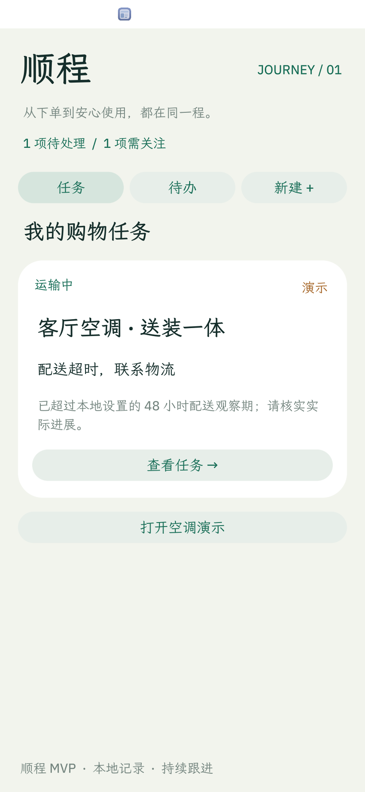
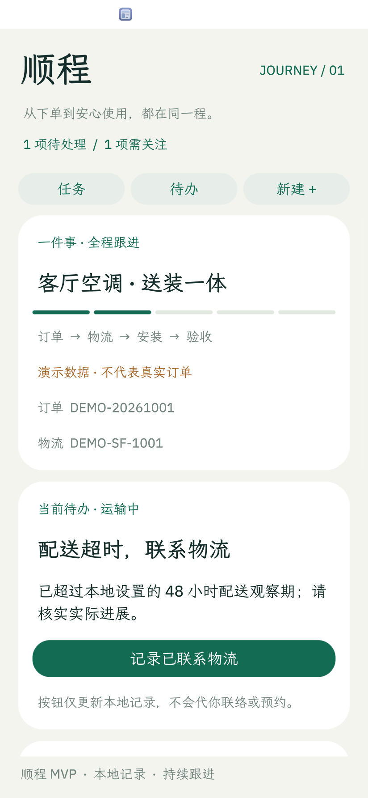
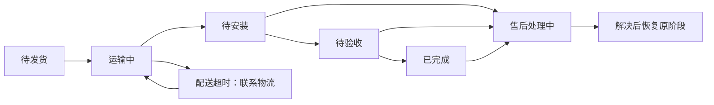

# 顺程 Journey

**从下单到安装，再到售后，让一笔购买始终是一项任务。**

顺程是运行在 **OctoSense** 内的购物与物流应用，以「购买并安装一台空调」为 MVP 场景。订单号、配送进度、安装安排和售后问题共用一条时间线；每次记录进展，应用都会重新计算下一步需要处理的事项。

当前版本：`0.1.0` · 应用 ID：`journey` · 黑客松 MVP · 已在 macOS Apple silicon 验证。

## 界面预览

下图来自真实原生应用，展示明确标记的演示任务和配送延误后的待办。

<p>
  
  
</p>

## 解决什么问题

买一台空调的事情不会在付款后结束。配送、联系物流、预约安装、验收和故障处理往往分散在不同记录里，用户需要不断回忆「现在该找谁、做什么」。顺程把这些进展保留在同一项任务中，让待办随实际状态变化。



MVP 的 agentic 能力由**规则驱动的持续状态更新**和**可选模型建议**组成：规则决定当前待办，模型提供只读建议。模型不会直接修改任务或向商家执行操作；当前未注册独立后台 Agent。

## 已实现

| 能力 | 当前行为 |
| --- | --- |
| 多任务管理 | 记录商品、订单号和物流单号；手动任务与演示任务分开保存 |
| 持续更新待办 | 根据阶段、配送观察期和售后状态推导下一步、原因及关注数量 |
| 配送跟进 | 本地 48 小时观察期到期后提示联系物流；记录联系后等待反馈，收货后转入安装 |
| 安装与验收 | 记录已约定的安装安排，再手动确认安装完成并验收 |
| 售后闭环 | 收货后可记录问题；结案后恢复被打断的阶段，完成的任务也可再次进入售后 |
| 事件时间线 | 保留进展记录，重启后恢复任务及待办 |
| 模型建议 | 用户主动请求系统 `model.complete`；模型不可用时继续使用规则流程 |
| 演示入口 | 一键建立空调演示任务，主动模拟配送延误 |

## 快速开始

### 1. 准备 OctoSense 开发环境

本仓库是原生 Splash 应用，需要 OctoSense 工具链；没有浏览器前端或 npm 安装步骤。

- 本项目已验证平台为 **macOS Apple silicon**，需要图形会话。
- 安装 Git、Python 3.9+ 及 Rust 工具链。
- 按 [OctoScript 官方快速开始](https://github.com/OctoSense-org/OctoScript-App-Design-Flow/blob/main/docs/QUICKSTART.md) 准备依赖，构建 `hub` 和 `card-host`。
- 如需在完整系统内体验，还需按 [OctoSense 仓库说明](https://github.com/OctoSense-org/OctoSense) 构建桌面程序。

将本仓库克隆到同一工作区，默认目录关系如下（运行时源码依赖按官方指南准备）：

```text
workspace/
├── OctoScript-App-Design-Flow/   # tools/octo
├── OctoSense-App-Hub/           # target/release/hub、card-host
├── OctoSense/                   # target/release/octosense
├── makepad/
├── octoscript/
├── octoscript-makepad/
└── octosense-journey/           # 本仓库
```

下面的命令均在 `octosense-journey/` 内执行。上游依赖不包含在本仓库中；完整依赖构建步骤以上游指南为准。本项目验证所用桌面版本为 OctoSense `6c4746f`。

### 2. 快速运行应用

```sh
./scripts/check.sh
./scripts/run.sh --port 8152
```

这会在独立 `card-host` 中打开应用，适合修改界面和验证业务流程。关闭窗口即可退出；也可通过本机测试桥结束该实例：

```sh
curl -s http://127.0.0.1:8152/quit
```

`card-host` 不提供完整系统模型服务，模型建议显示不可用提示属于预期行为。

### 3. 在 OctoSense 系统内体验

```sh
python3 scripts/prepare-local-store.py
python3 scripts/desktop.py
```

首次打开 App Hub 后，选择 **顺程 → Get → Install → Open**。安装完成后，再次运行 `desktop.py` 会直接打开顺程。

准备脚本仅在 `build/` 中生成一次性本地测试密钥、签名副本和私有商店目录，**不会发布到远程 App Hub**。桌面状态与安装数据分别保存在 `build/desktop-home/` 和 `build/desktop-apps/`。

修改 `bundle/` 后，需要重新运行准备脚本并在测试商店重新安装；现有安装副本不会随源码自动更新。重新安装前请备份需要保留的测试数据。

### 自定义工具路径

默认使用上述相邻目录。需要时可设置以下环境变量，建议使用绝对路径：

| 变量 | 用途 |
| --- | --- |
| `OCTO_TOOL` | `run.sh`、`check.sh` 和原生测试使用的 `tools/octo` |
| `OCTO_HUB` | 本地商店准备脚本及 `tools/octo` 使用的 `hub` |
| `OCTO_CARD_HOST` | `tools/octo` 使用的 `card-host` |
| `OCTOSENSE_BIN` | 桌面程序路径；`desktop.py` 仍要求相邻的 `OctoSense/` 目录存在 |
| `JOURNEY_TEST_PORT` | 原生测试端口，默认 `8153` |

## 3 分钟演示

1. 首页点击 **体验空调演示**（已有演示任务时显示 **打开空调演示**）。
2. 在任务详情点击 **演示：配送延误**，观察下一步变为联系物流。
3. 记录已联系物流，再确认已收货；配送待办消失，下一步切换为安装。
4. 填写已经约定的安装安排，例如「周六 09:00–12:00，已与师傅确认」，进入待验收。
5. 记录「配件缺失」的售后问题；记录问题已解决后回到待验收，再确认安装完成并验收。
6. 在已完成任务中记录使用故障，处理后结案，查看从订单到售后的完整时间线。

安装安排只是本地记录，演示事件也不代表真实物流更新。可另建一个手动任务，对比两项任务各自独立的进度。

## 检查与测试

```sh
./scripts/check.sh
python3 tests/native_smoke.py
```

2026-10-01 的验证记录：

- **15 项原生交互检查通过**，涵盖任务创建、配送延误、安装、售后恢复、跨任务隔离、模型不可用、重启恢复及损坏存档保护。
- 应用准入检查通过；源码包未签名，检查会提示发布者签名警告。
- 已通过 OctoSense App Hub 完成本地安装、打开，并在系统内创建演示任务和更新配送状态。

测试驱动实际原生界面，使用独立状态目录，并在结束后退出自己启动的测试实例。结果和日志保存在被 Git 忽略的 `build/` 内。详细证据及验证范围见 [验证记录](docs/VALIDATION.md)。

## 数据与当前边界

- **真实平台尚未接入**：没有电商账号、真实物流、安装商、付款或退款接口。业务按钮只更新本地记录。
- **更新时机**：应用打开及运行期间每分钟重算待办；关闭后不后台运行或推送。48 小时是本地演示观察阈值，不是承运商承诺。
- **本地存储**：任务保存在应用独立存储空间的 `journeys.json`，没有云端同步。最多 30 项任务，每项保留最近 80 条事件，时间显示为 UTC+8。损坏存档会保留原文件并阻止编辑，需备份后手动修复。
- **模型请求**：仅在用户主动请求时，将商品名称、阶段、下一步及原因交给系统模型服务；不包含订单号、物流单号、安装备注或售后自由文本。请求可能由系统配置的外部模型提供方处理，商品名称中请勿填写敏感信息。真实模型成功响应尚未验证。
- **权限**：仅声明 `storage`、`model`，未声明外部网络主机；应用不保存 API Key。
- **发布状态**：Android / iOS 未验证；发布者、支持链接和隐私网址仍含模板占位符。GitHub 源码发布不等于正式 App Hub 上架，正式提交前需要补齐发布资料并完成签名与审核。

## 项目结构

| 文件 | 说明 |
| --- | --- |
| [bundle/main.splash](bundle/main.splash) | 状态逻辑、待办推导及原生界面 |
| [bundle/manifest.json](bundle/manifest.json) | 应用标识、版本及权限 |
| [bundle/listing.json](bundle/listing.json) | 本地演示商店资料，含待替换的发布占位符 |
| [bundle/screenshots/](bundle/screenshots/) | 真实原生界面截图 |
| [BRIEF.md](BRIEF.md) | MVP 范围和验收条件 |
| [scripts/](scripts/) | 本地运行、检查和系统内安装辅助脚本 |
| [tests/native_smoke.py](tests/native_smoke.py) | 原生端到端测试 |
| [docs/VALIDATION.md](docs/VALIDATION.md) | 验证结果及限制 |
| [docs/REVIEW.md](docs/REVIEW.md) | 本地自查记录，不代表正式商店审批 |

后续可扩展真实订单与物流事件接入、后台提醒、真实安装服务，以及由用户确认后执行的系统工具调用。这些属于后续方向，不在当前 MVP 中。
